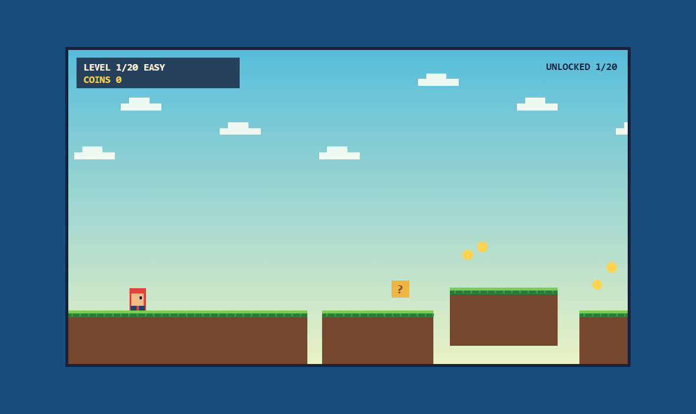

<div align="center">

# 🎮 Pixel Path
### *A Retro 2D Platformer Built with Vanilla JavaScript & HTML5 Canvas*

[](https://developer.mozilla.org/en-US/docs/Web/API/Canvas_API)
[](https://developer.mozilla.org/en-US/docs/Web/JavaScript)
[](https://developer.mozilla.org/en-US/docs/Web/CSS)
[](LICENSE)
[](https://deepakpradhan1021.github.io/Pixel_Path/)

[Play Online](https://deepakpradhan1021.github.io/Pixel_Path/) • [About This Project](#-about-this-project) • [Key Features](#-key-features) • [Game Controls](#-game-controls) • [Architecture](#-game-architecture--mechanics) • [Run Locally](#-how-to-run-locally) • [License](#-license)

</div>

---

## 🕹️ Play Online (Live Demo)

Play the full 20-level retro game directly in your browser:  
👉 **[Launch Pixel Path](https://deepakpradhan1021.github.io/Pixel_Path/)**

<br>

<div align="center">
  
</div>

---

## 📖 About This Project

Hi! I'm **Deepak Pradhan**, a student learning and progressing in **Frontend Web Development and Game Programming**.

While modern web development relies heavily on complex frameworks, I wanted to challenge myself to build a **complete, playable 2D physics platformer from scratch** using only **Vanilla JavaScript, HTML5 Canvas, and CSS**—with **zero external libraries or game engines**.

### 🎯 What I Wanted to Learn & Build:
- **Custom 2D Physics Engine:** Implement gravity, terminal fall velocity, horizontal momentum damping, coyote time, and jump buffering from pure mathematical equations.
- **Robust AABB Collision Detection:** Prevent the player from clipping through moving platforms or falling through solid tile edges.
- **Dynamic Level Generation:** Procedurally craft 20 progressively challenging stages across 5 distinct visual biomes (*Meadow*, *Forest*, *Caves*, *Sky Isles*, *Ember Keep*).
- **Web Audio Synthesis:** Generate dynamic retro 8-bit sound effects entirely on the fly using the browser's native **Web Audio API** (`AudioContext` oscillators).
- **Cross-Device Input Support:** Responsive touchscreen buttons for mobile players and keyboard controls for desktop users.

---

## ✨ Key Features

| Feature | Description |
| :--- | :--- |
| **🗺️ 20 Progressive Stages** | 5 themed biomes ranging from gentle introductory jumps to high-difficulty precision timing. |
| **⚙️ Custom Physics & Movement** | Includes jump buffering (0.12s window) and coyote time (0.1s grace period) for fluid, responsive platforming. |
| **🧱 Interactive Elements** | Breakable coin blocks (`?`), floating collectible coins, bounce springs, and moving floating platforms. |
| **👾 Enemy AI & Mechanics** | Patrolling ground enemies that turn around at platform edges and can be defeated with jump stomps. |
| **🚩 Checkpoints & State Saving** | Mid-level checkpoint flags and persistent level unlocking saved locally in `localStorage`. |
| **🔊 8-Bit Synthesized Sound** | Native Web Audio API procedural sound effects for coin collection, jumps, stomps, and stage progression. |
| **📱 Mobile & Desktop Friendly** | Fully responsive canvas layout with on-screen virtual d-pad touch controls on mobile devices. |

---

## 🎮 Game Controls

### 💻 Keyboard (Desktop)
- **Move Left / Right:** `A` / `D` or `Left` / `Right` Arrow keys
- **Jump:** `W`, `Up` Arrow, or `Spacebar` (supports variable jump heights)
- **Select / Navigate:** Mouse click on level selector menu

### 📱 Touchscreen (Mobile / Tablet)
- **Left / Right Buttons:** Bottom-left virtual arrow controls
- **Jump Button:** Bottom-right red action button

---

## 🏗️ Game Architecture & Mechanics

```
┌────────────────────────────────────────────────────────┐
│                   Game Loop (loop)                     │
│               requestAnimationFrame(loop)              │
└──────────────────────────┬─────────────────────────────┘
                           │
                           ▼
┌────────────────────────────────────────────────────────┐
│                   Physics Update (tick)                │
│  - Apply player velocity & momentum damping            │
│  - Apply gravity (1060 px/s²) & terminal velocity      │
│  - Coyote time & jump buffer tracking                  │
│  - Moving platform sinusoidal oscillation              │
│  - Enemy boundary detection & patrol reversal          │
│  - AABB bounding box collision resolution             │
└──────────────────────────┬─────────────────────────────┘
                           │
                           ▼
┌────────────────────────────────────────────────────────┐
│                    Canvas Render (draw)                │
│  - Biome background gradient interpolation             │
│  - Parallax cloud rendering                            │
│  - Camera offset translation (-cam_x)                  │
│  - Pixel-art terrain, spring pads, coin blocks & flags │
│  - Animated particle burst effects                     │
│  - HUD: Level, Coin Counter, and Checkpoint indicators │
└────────────────────────────────────────────────────────┘
```

---

## 📂 Project Structure

```text
Pixel_Path/
│
├── index.html       # Complete game engine, canvas renderer, CSS & level logic
├── screenshot.png   # In-game preview screenshot
└── README.md        # Project documentation & gameplay guide
```

---

## 💻 How to Run Locally

Because this game has zero external dependencies, running it locally requires no build step:

1. **Clone the repository:**
   ```bash
   git clone https://github.com/deepakpradhan1021/Pixel_Path.git
   cd Pixel_Path
   ```

2. **Open in any web browser:**
   - Simply double-click `index.html`, OR
   - Run a lightweight local server:
     ```bash
     # Python 3
     python -m http.server 8000
     ```
     Navigate to `http://localhost:8000`.

---

## 💡 Key Learnings & Takeaways

- **Platformer Feel & Juice:** Discovering that mathematically precise physics feel stiff; game feel requires forgiving mechanics like **coyote time** (jumping briefly after walking off a ledge) and **jump buffering** (registering jumps pressed just before landing).
- **Pixel Manipulation on Canvas:** Keeping pixel art sharp by disabling canvas anti-aliasing (`imageSmoothingEnabled = false`) and using integer pixel coordinates (`~~x`).
- **Zero-Dependency Sound Generation:** Synthesizing retro sounds using frequency modulation on `OscillatorNode` without storing large MP3/WAV audio files.
- **State Management & Persistence:** Using browser `localStorage` to save level progression across sessions.

---

## 🔮 Future Improvements

- [ ] Add sound effect toggle button (mute/unmute).
- [ ] Add speedrun timer and personal best records per level.
- [ ] Introduce additional enemy types (flying obstacles and hazard spikes).

## 📜 License

This project is open source and available under the [MIT License](LICENSE).

---

## 👤 Author

**Deepak Pradhan**
- 🐙 GitHub: [@deepakpradhan1021](https://github.com/deepakpradhan1021)
- 🎮 Play Live: [Pixel Path on GitHub Pages](https://deepakpradhan1021.github.io/Pixel_Path/)
- *Always open to constructive feedback, suggestions, and learning opportunities!*
